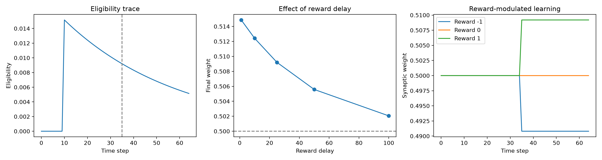
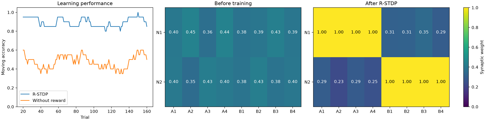
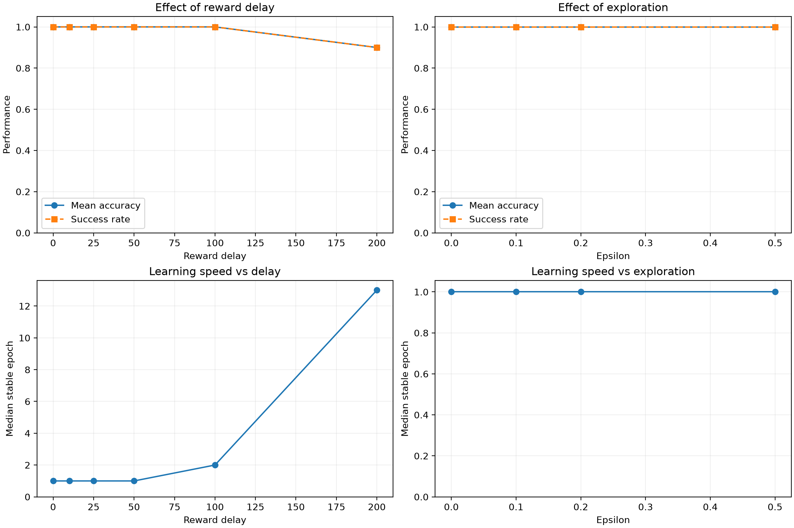

# Neuromodulated Plasticity in Spiking Neural Networks

A computational exploration of synaptic plasticity, competitive learning, eligibility traces, and reward-modulated spike-timing-dependent plasticity (R-STDP).

## Overview

This project investigates how spiking neural networks can learn through local synaptic plasticity rules rather than backpropagation.

Starting from a single plastic synapse, the experiments progressively introduce Leaky Integrate-and-Fire (LIF) neurons, unsupervised learning, neuronal competition, eligibility traces, and delayed reward signals.

All neuronal dynamics and learning rules are implemented from scratch using NumPy.

## Experiments

| Experiment | Description |
|---|---|
| 01 — STDP Basics | Pair-based synaptic potentiation and depression |
| 02 — STDP and LIF | Effects of synaptic plasticity on neuronal firing |
| 03 — Pattern Learning | Unsupervised learning of temporal spike patterns |
| 04 — Competitive STDP | Neuronal specialization through winner-takes-all competition |
| 05 — Eligibility Traces | Temporal credit assignment with delayed rewards |
| 06 — Reward-Modulated STDP | Stimulus-action learning through reward signals |
| 07 — Parameter Study | Robustness to reward delay, exploration, and weight initialization |

## Learning Rule

The reward-modulated learning rule combines three factors: presynaptic activity, postsynaptic activity, and a modulatory reward signal.

The eligibility trace stores recent STDP contributions and decays exponentially over time. Synaptic weights are updated only when a nonzero reward signal is received.

This mechanism allows delayed feedback to influence previously active synapses.

## Main Results

### Competitive Learning

Two postsynaptic neurons developed distinct stimulus preferences through STDP and winner-takes-all competition, without class labels.

### Eligibility Traces

The experiments demonstrate that synaptic changes decrease exponentially with reward delay and depend on the sign of the reward signal.



### Reward-Modulated STDP

An eight-input, two-output spiking neural network learned two stimulus-action associations using delayed reward signals.

| Condition | Accuracy |
|---|---:|
| Before training | 50% |
| After R-STDP | 100% |
| Without reward | 50% |



### Robustness Analysis

A total of 90 training runs were performed across nine parameter configurations and ten weight initialization seeds.

| Reward delay | Success rate | Median stable epoch |
|---:|---:|---:|
| 0 | 100% | 1 |
| 10 | 100% | 1 |
| 25 | 100% | 1 |
| 50 | 100% | 1 |
| 100 | 100% | 2 |
| 200 | 90% | 13 |

Overall, 89 out of 90 training runs successfully learned both stimulus-action associations.

All tested exploration probabilities achieved a 100% success rate at the baseline reward delay, including the configuration without explicit exploration.



## Limitations

The experiments use small networks and deterministic synthetic spike patterns. Action selection occurs at a fixed time using a simplified winner-takes-all mechanism.

The reward signal is an abstraction of neuromodulation rather than a biophysical model of dopamine.

The robustness study evaluates different weight initializations while keeping the training random seed fixed. Results demonstrate stimulus-action learning, not generalization to unseen stimuli.

## Installation

```bash
pip install numpy matplotlib
```

## Usage

Run the individual Python scripts to reproduce each experiment.

```bash
python 06_reward_modulated_stdp.py
python 07_rstdp_parameter_study.py
```

Generated figures are saved in the `figures/` directory.

## References

Frémaux, N., & Gerstner, W. (2016). Neuromodulated Spike-Timing-Dependent Plasticity, and Theory of Three-Factor Learning Rules. *Frontiers in Neural Circuits*, 9, 85.

https://doi.org/10.3389/fncir.2015.00085

## Project Context

This independent project follows the LIF-to-SNN project, which explored spiking neural networks trained through surrogate-gradient backpropagation.

The present work investigates an alternative learning paradigm based on biologically inspired local synaptic plasticity and reward modulation.